# TECHFEST — BEYOND DIMENSIONS

An immersive, scroll-driven 3D web experience built for the Techfest *Build in 3D* challenge.
Technology is not something visitors read about here — it is a world they enter, move through,
and take direct control of.

TECHFEST is a single-page, production-ready front-end experience. One continuous WebGL scene
runs behind the entire page while a damped camera travels between five chapters, and a separate
playground lets visitors rotate, re-material and inspect a live 3D object. It is a fictional
interface: the chapters are artistic representations of AI, robotics and space, not simulations
of real systems.

> **Status: independent concept build. ** All event names, dates, venues, formats, tracks and
> channels in this repository are **editable sample content**, labelled as such in the UI itself.
> Nothing is presented as verified official Techfest information, and no institutional
> affiliation, statistic or sponsor is claimed. See [Editing the content](#editing-the-content).

**Live demo:** _not deployed at the time of writing._ Instructions are in
[Deployment](#deployment); replace this line with the live URL once it is published and verified.

---

## Features

**One world, one camera** — the hero, all five chapters and the finale share a single fixed
full-screen canvas. Each section owns a *shot* (camera position, look-at target, dolly distance)
and a damped rig interpolates between them, so navigating reads as one continuous flight rather
than a set of cuts. Off-screen chapters hide behind their own presence curve, and the render
loop stops entirely while the DOM-only sections are on screen.

**Five connected chapters** — a procedural metallic energy core opens the journey and recurs
throughout: the same core up close, then a neural lattice, a mechanical assembly, a banded
planet with moons on inclined orbits, and finally all three element families converging into one
composition. Two chapters expose an *Inspect* control that pulls the camera into detail.

**A playground that writes to a live scene** — drag or arrow-key rotation, a camera-distance
slider, four real material paths (polished metal, transmissive glass, emissive core, matte
composite), wireframe, pause, auto-orbit, reset view, hover highlighting and click-to-inspect
parts. Every control mutates the rendered frame; none of them decorates a picture of it.

**Two themes, one click** — the page ships dark by default and the header switch converts the
whole site to the light graphite/silver palette. The choice persists in `localStorage`, is
re-applied by a pre-paint script so a saved theme never flashes, and drives the 3D materials too
— by cross-fading them per frame rather than rebuilding the scene. See [Theming](#theming).

**Nothing ever freezes** — every object carries idle motion on top of the scroll choreography,
so a reader who stops scrolling still sees a running machine: rings wobble on their radius, the
lattice drifts while its edges rebuild from live node positions, assembled parts micro-vibrate,
moons precess, and the finale's shards keep tumbling after they lock into formation.

**A background with a life of its own** — `AmbientBackdrop` adds a drifting dust field and three
breathing haze bands parked at different depths down the corridor, so no chapter reads as
geometry floating on a flat fill.

**Six-category event explorer** — editorial cards with distinct procedural SVG visuals and
tilt-on-pointer depth, each opening a real focus-trapped dialog with format, duration, tracks and
outcomes. Escape closes it and restores focus.

**Cinematic grade** — bloom, film grain, vignette and an explicit neutral tone-map in a single
post-processing chain, applied on capable devices and switched off entirely on the low tier.

**Sticky navigation with no dead links** — active-section highlighting, a scroll-progress rail,
and a working mobile menu (`aria-expanded` state, Escape closes, tap targets sized for touch).
Social entries with an unconfigured `href` render as "not configured" instead of as a dead link.

**Craft details** — scroll-reveal copy timelines, a cursor-follow light ring driven by GSAP
`quickTo`, magnetic buttons, a custom SVG favicon, `prefers-reduced-motion` support that
collapses all ambient motion to a still frame, and a static fallback for machines without WebGL
that can be forced with `?static=1`.

---

## Tech stack

| Concern | Choice |
| --- | --- |
| Framework | React 19 + TypeScript 5.9 (strict, `verbatimModuleSyntax`) |
| Build tool | Vite 8 (`@vitejs/plugin-react`, Rolldown) |
| Styling | Tailwind CSS v4 via `@tailwindcss/vite`, tokens in `@theme` |
| 3D | Three.js 0.186 + `@react-three/fiber` 9 + `@react-three/drei` 10 |
| Post-processing | `@react-three/postprocessing` + `postprocessing` |
| Scroll | GSAP 3.15 + ScrollTrigger (camera, progress, copy timelines, `quickTo` cursor) |
| UI motion | framer-motion 14 — interface transitions only |
| Icons | lucide-react |
| Fonts | Space Grotesk + JetBrains Mono, latin subsets from Google Fonts with a system fallback stack |

**Everything in the 3D world is procedural.** No model file, HDRI or texture image is
downloaded or committed — geometries are built in code and sprites (glow, planet bands, gear
profiles) are painted to a canvas at runtime. Orbiting in the playground is drei's
`OrbitControls`, not custom maths.

There is no state-management library: see [Scroll never re-renders React](#scroll-never-renders-react).

Unlike the 3D assets, the two webfonts *are* fetched at runtime from `fonts.googleapis.com`.
The page still renders correctly offline on the system fallback stack.

---

## Getting started

**Prerequisites:** Node.js 20+ and npm 10+, and a WebGL2-capable browser for the 3D world
(WebGL1 also works; without either, the static fallback is used automatically).

```bash
npm install       # install dependencies
npm run dev       # start the dev server (http://localhost:5173)
```

### Available scripts

| Command | Description |
| --- | --- |
| `npm run dev` | Vite dev server with HMR. |
| `npm run build` | Type-check (`tsc -b`), then produce the production bundle in `dist/`. |
| `npm run preview` | Serve the built `dist/` folder locally. |
| `npm run lint` | ESLint over the whole project (flat config, `typescript-eslint`, `react-hooks`, `react-refresh`). |
| `npm run typecheck` | `tsc -b --noEmit`. |

---

## Project structure

```
.
├── index.html                  # metadata, theme-color, pre-paint theme script, root mount
├── vite.config.ts              # react + tailwind plugins, manual three/motion chunks
├── public/
│   └── favicon.svg             # original hex-core mark
├── docs/screenshots/           # the images in the gallery below
└── src/
    ├── main.tsx                # React root + WebGL capability probe
    ├── App.tsx                 # page composition, error boundary, fallback switch
    ├── animations/
    │   └── scrollAnimations.ts # ScrollTrigger wiring, active-section observer, copy timelines
    ├── components/
    │   ├── Navbar.tsx          # sticky nav + mobile menu
    │   ├── ThemeToggle.tsx     # light/dark switch wired to localStorage
    │   ├── Modal.tsx           # focus-trapped dialog
    │   ├── EventCard.tsx       # tilt card + procedural visual
    │   ├── EventVisualSvg.tsx  # six generated category graphics
    │   ├── MagneticButton.tsx  # pointer-attracting CTA
    │   ├── CustomCursor.tsx    # cursor-follow light ring (GSAP quickTo)
    │   ├── ScrollProgress.tsx  # progress rail
    │   ├── LoadingScreen.tsx   # timed intro reveal
    │   └── WebGLFallback.tsx   # static path + SceneErrorBoundary
    ├── config/
    │   ├── site.ts             # wordmark, hero copy, nav, chapters + camera anchors, About, CTA
    │   ├── events.ts           # the six event categories
    │   ├── playground.ts       # material list + inspectable component specs
    │   └── palette.ts          # 3D mirror of the CSS tokens + per-tier quality budgets
    ├── hooks/useAppState.ts    # theme, media queries, WebGL probe, store access
    ├── scenes/
    │   ├── WorldCanvas.tsx     # the shared canvas, CameraRig, StarField, lights
    │   ├── AmbientBackdrop.tsx # drifting dust + breathing haze bands
    │   ├── Effects.tsx         # the post-processing grade
    │   ├── HeroScene.tsx       # energy core
    │   ├── AIScene.tsx         # neural lattice
    │   ├── RoboticsScene.tsx   # mechanical assembly
    │   ├── SpaceScene.tsx      # planet, moons, sun
    │   ├── InnovationScene.tsx # finale shard formation
    │   ├── PlaygroundScene.tsx # the interactive object
    │   └── lib/textures.ts     # procedural canvas textures and geometry helpers
    ├── sections/               # Hero, Experience, Playground, Events, About, FinalCTA, Footer
    ├── state/world.ts          # mutable motion state + discrete external store
    └── styles/globals.css      # design tokens, component classes, layout
```

---

## Design system

Every colour in the UI is a semantic token, never a literal. `src/styles/globals.css` declares
two value sets and maps them onto Tailwind utilities through `@theme`; `paletteFor(theme)` in
`src/config/palette.ts` mirrors the same values for the 3D materials, which is what lets one
toggle re-tint the WebGL scene and the DOM together.

| Token | Role | Dark (default) | Light |
| --- | --- | --- | --- |
| `--c-void` | page background | `#050507` | `#f7f7f8` |
| `--c-ink` | headings, wordmark | `#f4f5f7` | `#0a0b0e` |
| `--c-muted` | body copy | `#8d919c` | `#575b64` |
| `--c-surface` | cards, panels | `rgba(255,255,255,.045)` | `rgba(10,11,14,.035)` |
| `--c-raised` | hovered panels | `rgba(255,255,255,.09)` | `rgba(10,11,14,.07)` |
| `--c-line` | borders, dividers | `rgba(255,255,255,.14)` | `rgba(10,11,14,.16)` |
| `--c-accent` | primary electric blue | `#2e7bff` | `#1552c9` |
| `--c-violet` | secondary accent | `#7c5cff` | `#5936d3` |
| `--grid-line` | technical grid | `rgba(255,255,255,.05)` | `rgba(10,11,14,.05)` |

- **Type** — `--font-display` (Space Grotesk) for headings and body, `--font-mono`
  (JetBrains Mono) for HUD labels, kickers and readouts.
- **Type scale** — `clamp()`-driven hero lockup, tight `-0.03em` tracking and `0.95` line-height
  on display headings, wide-tracked 10–11 px mono labels.
- **Effects** — the near-black background is never a flat fill: a technical grid, section-level
  gradient washes and the live 3D scene composite underneath the copy. In light mode the same
  tokens flip to soft silver so glows become tints instead of glare.
- Custom classes live inside `@layer components`, so Tailwind utilities always win at the call
  site.
- `text-wrap: balance` on headings and `pretty` on paragraphs keeps the editorial line breaks
  without per-breakpoint overrides.

---

## Theming

```
:root                     { --c-void: #050507; … }   /* dark  — the default */
:root[data-theme="light"] { --c-void: #f7f7f8; … }   /* light */
@theme                    { --color-void: var(--c-void); … }
```

`useAppState()` keeps the current theme in the store, sets `data-theme` on `<html>`, updates
`color-scheme`, syncs the `theme-color` meta tag and writes `localStorage['techfest-theme']`. A
tiny inline script in `index.html` reads the same key **before first paint**, so reloading in a
saved theme never shows a frame of the wrong palette; on a first visit it defers to the
operating-system preference.

`@custom-variant dark` is redefined to that attribute, so `light:` utilities follow the user's
choice rather than the OS setting.

**The 3D world cross-fades instead of rebuilding.** Toggling does not reconstruct materials or
lights — each frame lerps colours and intensities toward the target palette, so the switch reads
as a dissolve. Only the locally-rendered reflection environment remounts, which is a single
cheap pass, and the canvas itself is never re-created.

---

## How the 3D world is wired

### Scroll never re-renders React

`src/state/world.ts` splits state in two:

- `motion` — a plain mutable object holding per-section progress, pointer, camera targets, the
  intro timer and inspect targets. ScrollTrigger writes into it; scenes read it inside
  `useFrame`. **Zero React renders per scroll or pointer tick.**
- A small external store (`getWorld` / `setWorld` / `subscribeWorld`) consumed through
  `useSyncExternalStore`, for discrete facts only: theme, quality tier, active section, pause,
  WebGL availability.

Frame-rate-independent easing uses one helper, `damp(delta, lambda) = 1 - e^(-lambda·delta)`, so
motion looks identical at 60 and at 144 Hz.

### The background is a layer of its own

`src/scenes/AmbientBackdrop.tsx` sits behind the narrative objects:

- **Drifting motes** — a points cloud (110 / 200 / 340 by device tier) that rotates, rides a
  lateral current and inhales on a scale curve, with its own size and opacity pulse. The current
  matters: the field sits far downrange, so a purely angular crawl never crosses a perceptible
  pixel delta and the hero background measures as still. Every mote is placed *behind* the near
  plane (`z <= -12`), because one passing through it would flash a screen-filling blob.
- **Breathing haze** — three large sprites parked at different depths down the corridor, so at
  least one is always in frame. Each wanders a lazy ellipse and swells on its own phase offset,
  and position and scale run on different clocks, so the bands never pulse in lockstep.

Both are fog-exempt with `depthWrite={false}` so they read as atmosphere rather than geometry,
and both lerp to opposite palette values in light mode instead of re-mounting. The star field
breathes the same way.

### Budgets, not guesses

Adaptive DPR and particle/geometry budgets come from `qualityTiers` in `src/config/palette.ts`,
chosen from pointer type and core count at startup. Instanced meshes carry the satellites, moons
and particle clouds; geometries and canvas textures are shared; there are no real-time shadow
maps. The playground chunk — and therefore its second canvas — is code-split and mounts on first
view. GPU resources are disposed on unmount, and GSAP timelines, observers and listeners are
killed on teardown.

---

## Accessibility

Measured, not assumed. Both themes were audited programmatically in headless Chrome: text nodes
were enumerated per section, their glyphs hidden to capture the *actual composited backdrop*
(median luminance, so a few bright scene pixels cannot skew a dark region), and contrast computed
against each node's declared colour — 4.5:1 for small text, 3:1 for large.

| Theme | Visible text nodes measured | WCAG 2 AA failures | Worst ratio |
| --- | --- | --- | --- |
| Dark | 94 | **0** | 4.56:1 |
| Light | 94 | **0** | 5.82:1 |

Text sits over live 3D content, so contrast was measured against the rendered frame rather than
against the flat page token.

- One `h1`, nine `h2`s; landmarks (`header`, `nav`, `main`, `footer`, ten `section`s) and a
  "Skip to content" link. `lang="en"` on the document.
- **0 buttons without an accessible name** across the page. The theme control states its full
  action in `aria-label` at every width; the mobile menu toggles `aria-expanded`.
- The event dialog uses `role="dialog"` + `aria-modal`, moves focus in, traps Tab, closes on
  Escape and restores focus — all four states confirmed in the DOM.
- Two `aria-live` regions announce state changes; playground controls expose pressed/checked
  state.
- Keyboard: focus-visible rings, full navigation, chapter *Inspect* controls, playground
  arrow-key rotation and `+`/`-` zoom.
- `prefers-reduced-motion: reduce` is honoured throughout: the intro resolves instantly, camera
  damping becomes near-instant, drift and auto-orbit stop, the custom cursor and card tilt
  disable, and copy appears rather than animating.
- All narrative, event and control text is DOM content and stays readable with the 3D world
  absent. `?static=1` forces the no-WebGL fallback so that path can be reviewed on any machine.

---

## Performance

Production bundle from `npm run build`, measured on the current commit:

| Chunk | Raw | Gzipped |
| --- | --- | --- |
| `three` | 1,291.85 kB | 357.16 kB |
| `motion` (React + framer-motion + GSAP) | 252.05 kB | 89.85 kB |
| `index` (app code) | 77.46 kB | 25.79 kB |
| `Playground` (lazy) | 14.71 kB | 5.49 kB |
| runtime | 0.71 kB | 0.42 kB |
| **CSS** | 35.48 kB | 8.24 kB |

Roughly **479 kB gzipped JS**, of which Three.js is 357 kB — unavoidable for real 3D, and
mitigated by splitting the playground into its own lazy chunk and by stopping the render loop
whenever the narrative world is off screen.

- The post-processing grade runs as a single composer on the high and medium tiers and is
  switched off entirely on `low`. It carries an explicit tone-map effect because three skips a
  material's tone mapping whenever it renders into a target instead of the screen.
- `frameloop="never"` while the DOM-only sections (playground, events, about) are on screen, so
  the full-screen world costs nothing there.
- No more than one large 3D surface ever renders at a time: the world canvas is fixed and
  full-screen, the playground canvas is contained.
- The page renders no raster `` elements at all — visuals are the WebGL canvas plus inline
  SVG — so there is no image weight and no layout shift from late media.

---

## Screenshots

Captured from the running dev server in headless Chrome at 1440×900 (desktop) and 390×844
(mobile). Dark is the default theme; the light pair shows the same page after one click of the
header switch.

| Hero | Chapter 02 — Artificial intelligence |
| --- | --- |
| 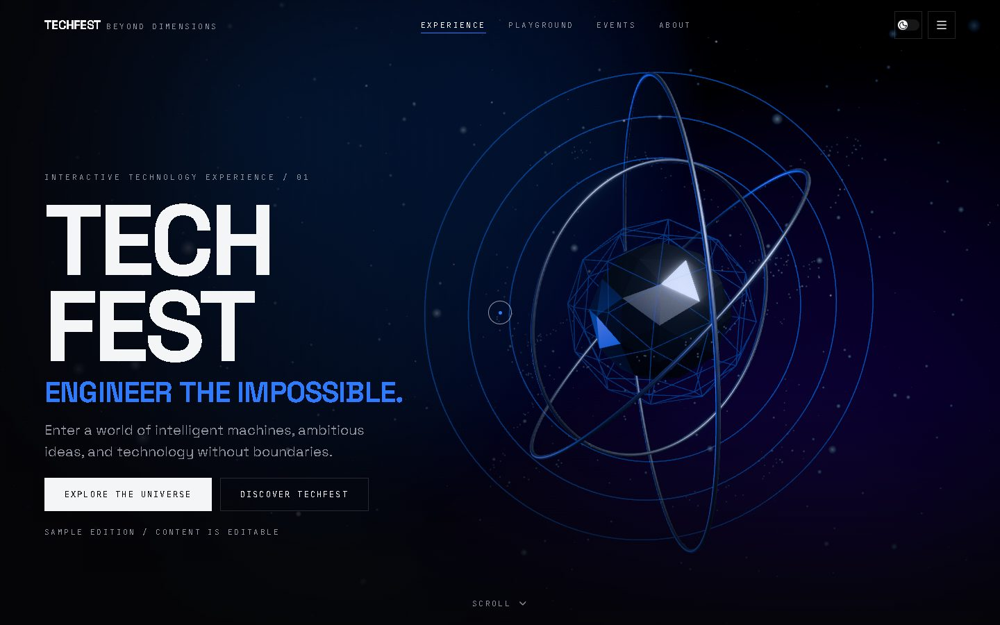 | 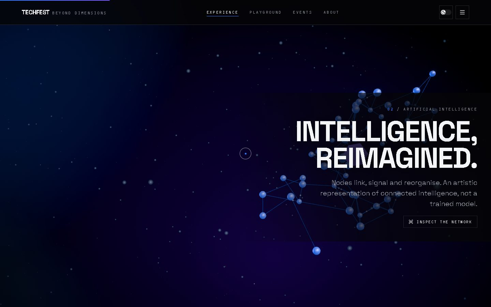 |
| The procedural energy core, rings and particle orbits. | The neural lattice; note the explicit "not a trained model" label. |
| **Chapter 03 — Robotics** | **Chapter 04 — Space** |
| 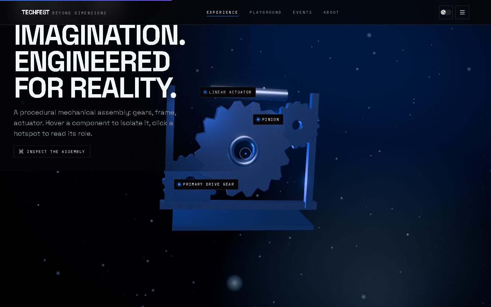 | 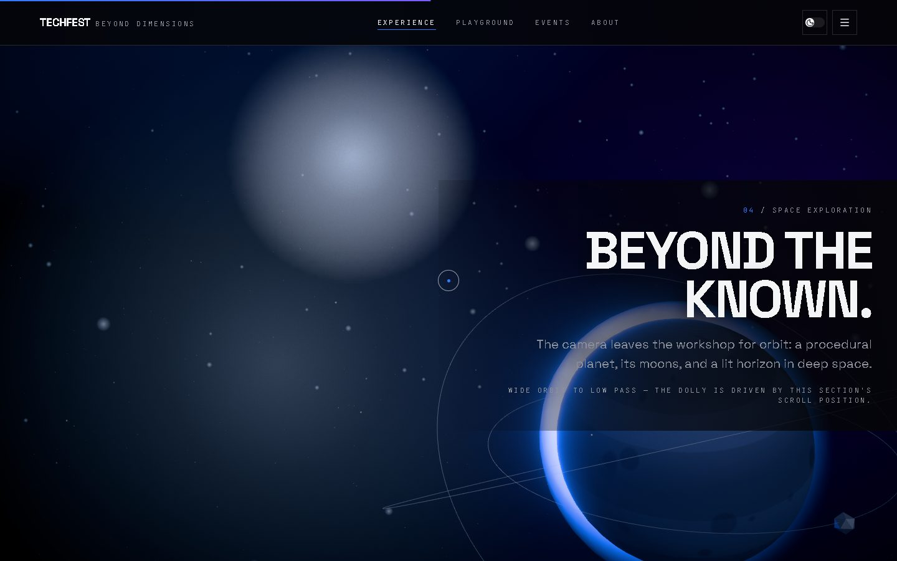 |
| Gears, pinion, actuator and chassis with labelled hotspots. | Banded planet, atmosphere rim and orbiting moons. |
| **Playground** | **Events** |
| 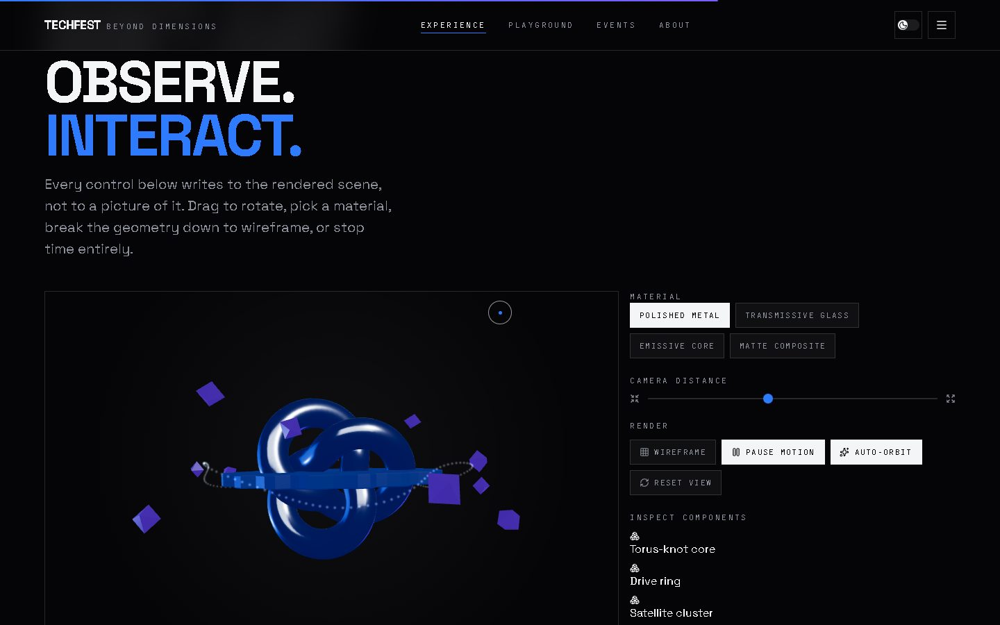 | 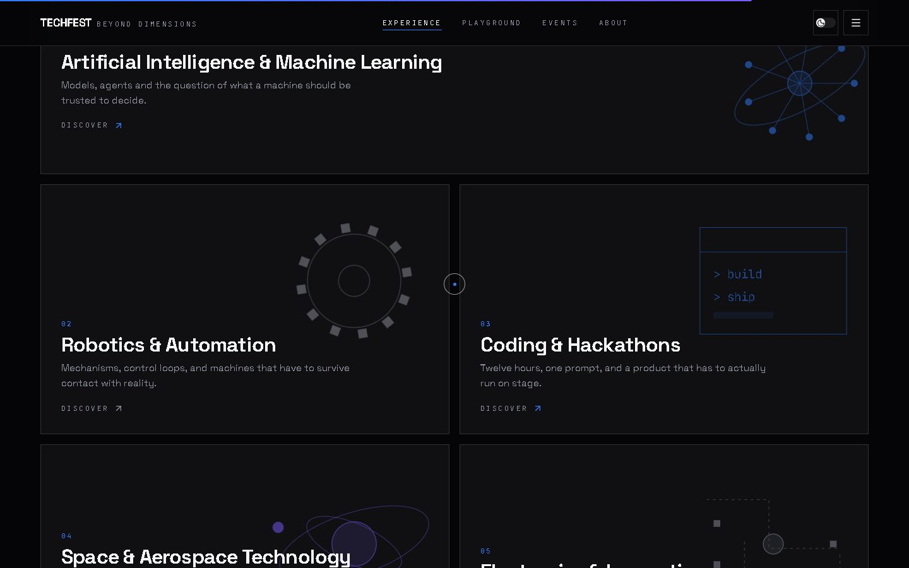 |
| Materials, distance, wireframe, pause, auto-orbit, inspect. | Six categories with generated visuals. |
| **Event dialog** | **About** |
|  | 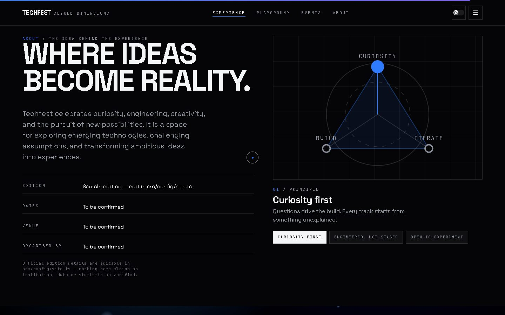 |
| Focus-trapped, Escape-closing, editable-content notice. | Principle diagram over a technical grid. |
| **Finale** | **Hero — light theme** |
| 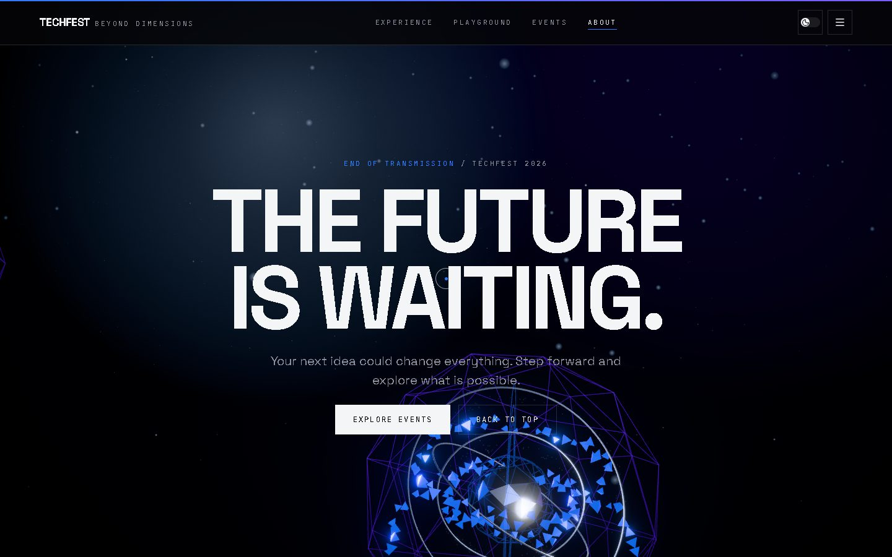 | 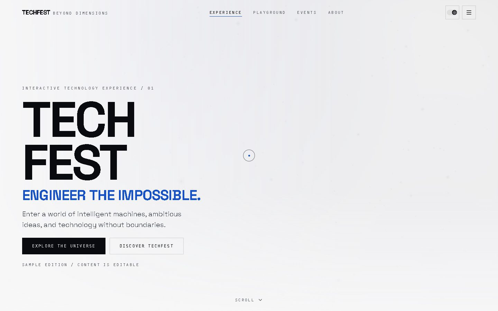 |
| Shard formation converging over the breathing backdrop. | One click of the header switch. |
| **Space — light theme** | **Mobile** |
| 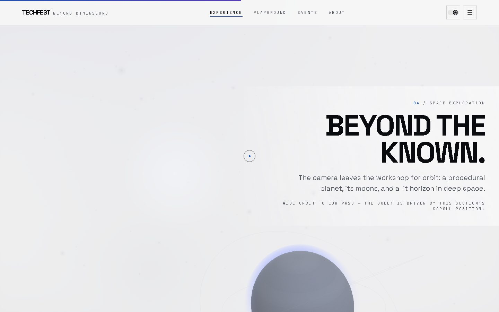 | 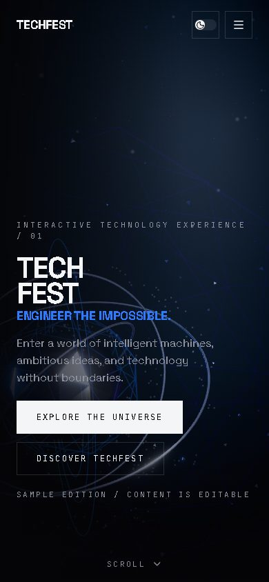 |
| Glows become soft tints rather than glare. | 390 px, no horizontal overflow. |
| **Mobile menu** | |
| 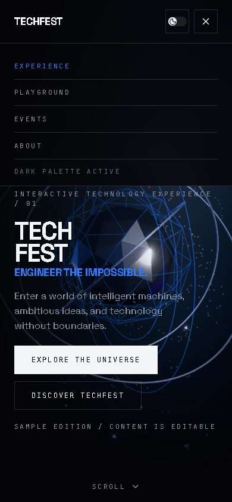 | |
| `aria-expanded` driven overlay. | |

---

## Editing the content

Everything user-facing is data, not JSX:

| File | Contains |
| --- | --- |
| `src/config/site.ts` | Wordmark, tagline, hero copy, nav items, chapter headings and their 3D camera anchors, About facts and principles, final CTA, social links, footer note. |
| `src/config/events.ts` | The six event categories: title, blurb, detail, format, duration, tracks, outcomes, visual variant, accent tone. |
| `src/config/playground.ts` | Playground material list and the inspectable component specs. |
| `src/config/palette.ts` | The dark and light 3D palettes and per-tier quality budgets. |

Before publishing an official edition, replace the placeholder values in `site.ts`
(`editionLabel`, `about.facts`) and `events.ts`, and fill in `socialLinks` — entries with an empty
`href` render as "not configured" rather than as dead links. The UI labels all of this as
illustrative content on its own; keep that notice until real details replace it.

---

## Deployment

The build output in `dist/` is fully static — no backend, no secrets, no API keys.

**Vercel / Netlify**

- Framework preset: *Vite*
- Build command: `npm run build`
- Output directory: `dist`

**GitHub Pages** — set Vite's `base` to the repository sub-path, build, and publish `dist`:

```bash
npm run build
npm i -D gh-pages
npx gh-pages -d dist
```

Then: Settings → Pages → Branch: `gh-pages` / root.

```bash
npm run build && npm run preview   # verify the production bundle locally before deploying
```

No environment variables are required. The page currently ships a `description` and
`theme-color` meta but no Open Graph or Twitter card tags — add those, plus an absolute `og:url`,
before sharing it socially.

---

## Demo recording

Not generated automatically. To capture the submission clip (30–60 s):

1. `npm run dev` and open the printed URL.
2. Record the viewport (OBS Studio, or Windows `Win` + `Alt` + `R`).
3. Let the hero reveal finish, then scroll slowly through chapters 01 → 05 so the camera move
   reads as one flight.
4. Pause on chapter 03 and hover a component, then click a hotspot.
5. In the playground, switch a material, toggle wireframe, and drag to rotate.
6. Open an event card and close it with Escape.
7. Click the theme switch and let the cross-fade complete.
8. Resize to ~390 px and open the mobile menu.

---

## Verification status

Verified in real headless Chrome (SwiftShader WebGL) against the dev server, with screenshots
reviewed at 1440×900 and 390×844 in both themes.

- `tsc -b`, ESLint and `vite build` all run clean.
- Theme toggle switches `data-theme`, writes `localStorage`, updates the `theme-color` meta and
  every 3D material, survives a reload, and never re-creates the canvas.
- Event modal opens from a card, exposes `role="dialog"`, and closes on Escape — all four states
  confirmed in the DOM.
- Playground controls write to the live scene: wireframe, material, part inspection and the
  distance slider each visibly change the rendered frame.
- **Continuous motion audit** — every visible object in all five chapters sampled twice, 800 ms
  apart, page idle. Every drawable object changed its world matrix (32–42 objects per chapter);
  the only static entries are the four fixed rig lights.
- **Ambient background audit** — two frames 1.6 s apart, diffed per pixel. With motion allowed,
  83.5% of the full frame changes in chapter 4 and 19.5% in the hero (35.4% across the background
  column beside the core). Under `prefers-reduced-motion` the same comparison falls to 0.4%, then
  0.1% on a second sample — a genuine still frame.
- **Contrast audit** — 94 text nodes per theme measured against the composited rendered backdrop;
  0 WCAG AA failures in either theme.
- Mobile: `scrollWidth === clientWidth === 390`, so no horizontal overflow.
- Console and network: no errors and no failed requests (the `/favicon.ico` 404 found in an
  earlier pass is fixed with an original `public/favicon.svg`).

---

## Known limitations

- Reflections come from a locally rendered light environment, not an HDRI, so metals read as
  stylised rather than photoreal.
- The robotics assembly is procedural and intentionally abstract; it is not a mechanical model of
  a real machine. Its composition also passes behind the chapter copy mid-section — the object
  reads cleanest near the end of the scroll range.
- The AI chapter is an artistic representation of connected systems and says so on screen; no
  model is trained, inferred or claimed.
- Drag-to-rotate on the background world is desktop-only. On touch devices the canvas ignores
  pointer events so vertical scrolling is never captured, and the playground provides
  touch-friendly rotation instead.
- The camera damps between section poses instead of cutting, so an extreme programmatic jump — or
  a theme switch taken far down the page followed by a jump to the top — leaves the hero
  re-framing for a second or two. It settles on its own, and is most visible under software WebGL,
  where the reflection environment also takes longer to regenerate.
- Webfonts are fetched from Google Fonts at runtime, unlike the fully procedural 3D assets.
- No audio: ambient sound was left out deliberately rather than shipping a half-finished,
  autoplay-prone feature.
- Content is sample data (see the notice at the top).

---

## Credit & licence

This is a concept build for the Techfest *Build in 3D* challenge. It is not affiliated with or
endorsed by any institution, and no licence is granted over the "Techfest" name or marks. There
is currently no `LICENSE` file in the repository — add one before publishing if you intend to
grant usage rights.

All 3D geometry, textures, SVG artwork and copy were generated for this project and live in the
repository; nothing is hotlinked except the two webfonts, which remain under the SIL Open Font
License 1.1.
